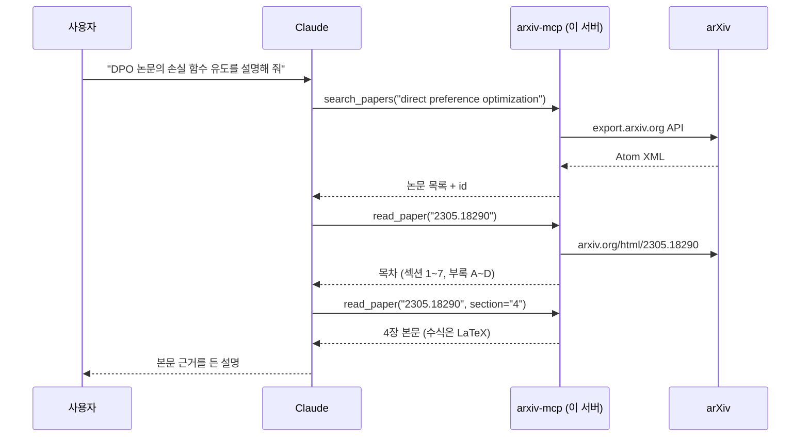

<div align="center">

# 📚 arXiv MCP Server

**Claude 같은 AI 에이전트가 arXiv 논문을 검색하고, 본문을 섹션 단위로 직접 읽게 해 주는 MCP 서버**


</div>

> 에이전트에게 "DPO 논문 4장 읽고 손실 함수 유도 과정 설명해 줘"라고 하면,
> 초록만 보고 짐작하는 대신 **실제 본문을 가져와서** 수식까지 근거로 답합니다.

---

## 🤔 MCP가 뭔가요?

**Model Context Protocol**은 AI 앱(Claude Desktop, Claude Code 등)이 외부 도구를 쓰는 표준 규격입니다.
서버가 "이런 도구가 있다"고 알리면 모델이 필요할 때 스스로 호출합니다. USB처럼 한 번 만들면 MCP를 지원하는 어느 앱에나 꽂아 쓸 수 있습니다.



## 🛠 도구

| 도구 | 하는 일 | 예시 |
|---|---|---|
| `search_papers(query, max_results=5, sort_by="relevance")` | 키워드 검색. 일반 단어는 **모두 포함**하도록 AND로 묶고, `ti:` `au:` `cat:` 같은 arXiv 문법도 그대로 지원 | `"vision transformer"`, `'ti:"diffusion" AND cat:cs.CV'` |
| `get_paper(arxiv_id)` | 저자, 날짜, 분야, 링크, 전체 초록 | `"2305.18290"`, `"https://arxiv.org/abs/1706.03762"` |
| `read_paper(arxiv_id, section="")` | 섹션을 안 주면 **초록 + 목차**(섹션별 길이 포함), 주면 **그 섹션 본문 전체**. 번호(`"4"`, `"A1"`)나 제목 일부(`"Experiments"`)로 고름 | `read_paper("2305.18290", "4")` |

**실제 호출 결과** (`python demo.py`):

```text
tools: search_papers, get_paper, read_paper

===== read_paper({'arxiv_id': '2305.18290'})
# Direct Preference Optimization: Your Language Model is Secretly a Reward Model
## Abstract
While large-scale unsupervised language models (LMs) learn broad world knowledge ...
## Sections
1. Introduction  (4,672 chars)
...
6. Experiments  (14,505 chars)
A1. Appendix A Mathematical Derivations  (13,226 chars)

===== read_paper({'arxiv_id': '2305.18290', 'section': '4'})
## 4. Direct Preference Optimization
... $\pi_{r}(y\mid x)=\frac{1}{Z(x)}\pi_{\text{ref}}(y\mid x)\exp\left(\frac{1}{\beta}r(x,y)\right),$ ...
```

## 🚀 연결하기

[uv](https://docs.astral.sh/uv/)가 있으면 클론 없이 GitHub에서 바로 실행됩니다.

**Claude Code**
```bash
claude mcp add arxiv -- uvx --from git+https://github.com/dain77-d/mcp-tool-server arxiv-mcp
```

**Claude Desktop**: `claude_desktop_config.json`에 추가합니다 (Windows `%APPDATA%\Claude\`, macOS `~/Library/Application Support/Claude/`).
```json
{
  "mcpServers": {
    "arxiv": {
      "command": "uvx",
      "args": ["--from", "git+https://github.com/dain77-d/mcp-tool-server", "arxiv-mcp"]
    }
  }
}
```

uv 없이 쓰려면 `pip install git+https://github.com/dain77-d/mcp-tool-server` 후 명령어를 `arxiv-mcp`로 지정하면 됩니다.

**이렇게 물어보세요**
- "최근 Mamba 계열 논문 5개 찾아서 무엇이 다른지 비교해 줘"
- "Attention Is All You Need의 3장을 읽고 multi-head attention을 수식과 함께 설명해 줘"
- "DPO 논문 실험 섹션에서 IMDb 실험 설정만 뽑아 줘"

## 🧩 설계 메모

- **왜 섹션 단위로 읽나:** 논문 전체(수만 자)를 한 번에 넘기면 컨텍스트가 낭비되고 정확도가 떨어집니다. 목차를 먼저 주고 필요한 섹션만 가져오게 하면, 에이전트가 사람처럼 "훑고 → 골라 읽기"를 합니다. 한 번에 최대 2만 자로 자릅니다.
- **수식은 LaTeX로:** arXiv HTML(LaTeXML)의 `<math alttext>`를 `$...$`로 바꿉니다. MathML을 텍스트로 풀면 기호가 뒤섞이지만, LaTeX는 모델이 그대로 읽고 다시 쓸 수 있습니다.
- **입력 검증:** 논문 id는 정규식으로 검증한 뒤에만 URL에 넣습니다(`2305.18290`, `arXiv:…v3`, abs URL, 구형 `hep-th/9901001` 허용). 엉뚱한 문자열이 요청 경로로 새지 않습니다.
- **본문이 없는 논문:** HTML 버전이 없는 오래된 논문은 404 대신 PDF 링크를 안내합니다.
- **의존성 최소화:** MCP SDK 외에는 표준 라이브러리(`urllib`, `xml.etree`, `html.parser`)만 씁니다.
- arXiv는 API 호출 사이에 3초 정도 간격을 권장합니다. 대량 수집용이 아니라 대화 중 몇 편 읽는 용도입니다.

## 🧪 개발

```bash
pip install "mcp>=2"
python test_arxiv_mcp.py   # 오프라인 테스트: id 검증, Atom/HTML 파싱, 섹션 선택, 도구 목록
python demo.py             # 서버를 stdio로 띄워 실제 MCP 클라이언트로 도구 호출 (arXiv 접속)
```

```
arxiv_mcp.py        서버 전체 (도구 3개 + 파서)
test_arxiv_mcp.py   네트워크 없이 도는 테스트
demo.py             MCP 클라이언트로 end-to-end 호출
pyproject.toml      uvx / pip 설치용 (명령어: arxiv-mcp)
```

## 🔗 관련

- [ai-study-log](https://github.com/dain77-d/ai-study-log): 매일 논문을 전문으로 읽고 정리하는 공부 로그. 이 서버가 하는 "본문까지 읽기"와 같은 문제의식입니다.
- [dpo-from-scratch](https://github.com/dain77-d/dpo-from-scratch): 위 예시의 DPO 논문을 직접 구현·재현한 레포
- [Model Context Protocol](https://modelcontextprotocol.io)
